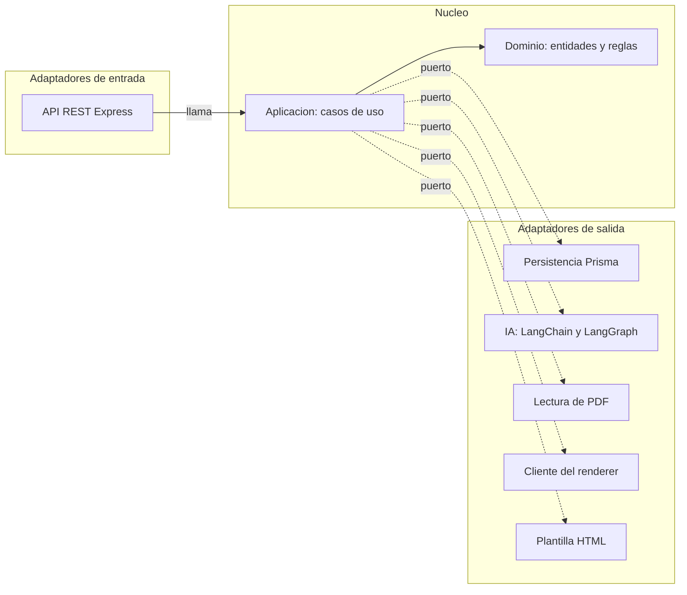
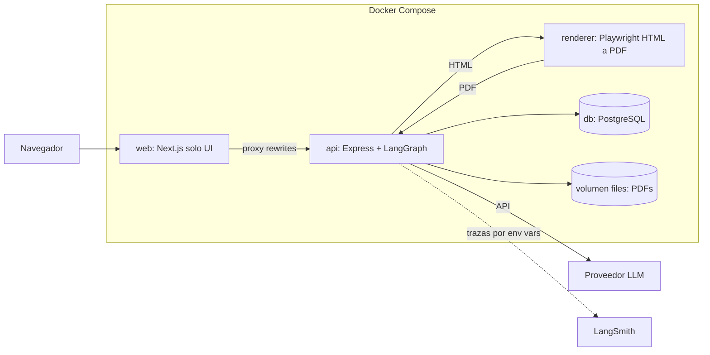
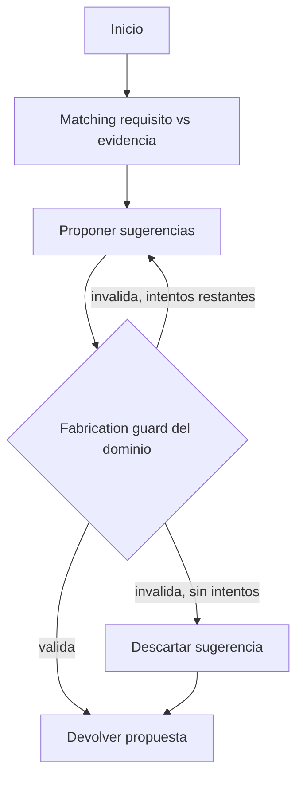
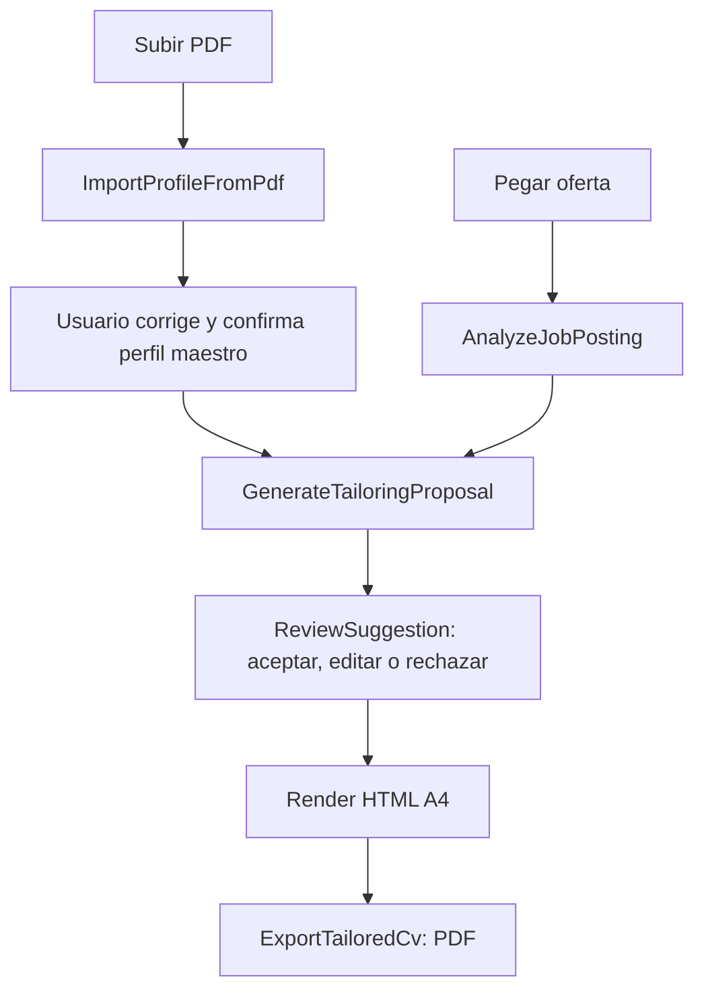

# 02 - Arquitectura

## 1. Arquitectura hexagonal (puertos y adaptadores)

El núcleo (dominio y aplicación) no conoce ni frameworks, ni base de datos, ni LLM, ni HTTP. Define puertos (interfaces) y los adaptadores los implementan. La dependencia siempre apunta hacia adentro.



Capas:

- **Dominio**: entidades (Profile, Bullet, JobPosting, Requirement, Suggestion...), objetos de valor y servicios de dominio puros: el fabrication guard, la normalización de keywords y alias, y las reglas de transición de estado de las sugerencias. Sin dependencias externas salvo Zod.
- **Aplicación**: casos de uso (`ImportProfileFromPdf`, `AnalyzeJobPosting`, `GenerateTailoringProposal`, `ReviewSuggestion`, `ExportTailoredCv`) y la definición de los puertos.
- **Puertos de salida** (definidos por la aplicación): `ProfileRepository`, `JobPostingRepository`, `TailoredCvRepository`, `ProfileExtractor` (de texto a perfil estructurado), `JobAnalyzer`, `TailoringProposer`, `PdfTextReader`, `CvHtmlRenderer`, `PdfGenerator`, `FileStorage`.
- **Adaptadores de entrada**: la API REST de Express. Valida con Zod, traduce HTTP a llamadas de casos de uso y errores de dominio a códigos HTTP.
- **Adaptadores de salida**: Prisma (repositorios), LangChain/LangGraph (extractor, analizador y proponedor), librería de PDF (lector de texto), cliente HTTP del servicio renderer, plantilla HTML.
- **Raíz de composición**: en `apps/api`. Es el único lugar donde se conectan casos de uso con adaptadores concretos (inyección de dependencias manual, sin contenedor DI).

Beneficio: los casos de uso se prueban sin LLM, sin base de datos y sin red, con adaptadores falsos en memoria; el proveedor de LLM, la base de datos o el generador de PDF se reemplazan sin tocar el núcleo.

Regla de pragmatismo: puertos solo donde hay una dependencia externa real. Sin interfaces por costumbre.

## 2. Servicios (Docker Compose)



- `web`: Next.js usado solo como interfaz (sin lógica de servidor propia). Las llamadas a `/api/*` se reenvían a `api` con `rewrites` (ADR-017); `api` no publica puertos al host y no usa CORS.
- `api`: Express con el adaptador HTTP, los casos de uso y los adaptadores de salida. Ejecuta los grafos de LangGraph dentro del proceso.
- `renderer`: servicio HTTP interno mínimo que recibe HTML y devuelve el PDF con Playwright. No conoce el dominio y no publica puertos al host.
- `db`: PostgreSQL 18 (ADR-013) con volumen `pgdata` montado en `/var/lib/postgresql`. `api` arranca cuando el `healthcheck` de `db` está sano. Las migraciones de Prisma se ejecutan con `pnpm db:migrate`, no en cada arranque.
- Volumen `files`: PDFs subidos y exportados, accedidos por el puerto `FileStorage`.
- Archivos: `docker-compose.yml` (base) y `docker-compose.dev.yml` (override con volúmenes y hot reload). `pnpm compose` usa los dos: `web` ejecuta `next dev` con el repo montado en `/app` y relee los archivos cada 300 ms. La caché de Next queda en el volumen `web_next`, aparte del código. `pnpm compose:prod` levanta solo el archivo base, con la imagen ya compilada. Secretos solo en `.env`, con un `.env.example` versionado.

## 3. IA: LangChain y LangGraph (dentro del adaptador de IA)

LangChain provee los modelos, parsers de salida estructurada (Zod) y prompts. LangGraph modela cada proceso de generación como un grafo con estado y reintentos. Todo vive en el adaptador de IA, que implementa los puertos `ProfileExtractor`, `JobAnalyzer` y `TailoringProposer`.

Grafos (sin estado persistente entre llamadas):

- **extractProfileGraph**: estructura el texto del CV a perfil, valida contra el esquema del dominio y reintenta con el error hasta 3 veces.
- **analyzeJobGraph**: segmenta la oferta, clasifica requisitos y extrae palabras clave. El dominio normaliza los alias y compara la oferta con el perfil.
- **proposeTailoringGraph**: propone sugerencias y las valida con el fabrication guard (servicio de dominio que el grafo invoca). Si falla, reintenta con el motivo hasta 3 veces y descarta lo que sigue inválido.



**La revisión humana NO se modela dentro de LangGraph**, sino en la capa de aplicación (ADR-015). Cada `Suggestion` se guarda con su estado (pendiente, aceptada, editada, rechazada) y el usuario lo cambia mediante el caso de uso `ReviewSuggestion`. Los grafos quedan sin estado, sin checkpointer y sin ejecuciones pausadas.

El proveedor del LLM es OpenAI (ADR-011) y se elige por configuración dentro del adaptador, mediante una fábrica de modelos (`ModelFactory`) que lee el `.env`:

- `LLM_PROVIDER=openai`
- `LLM_MODEL=<modelo>`. El ejemplo en `.env` es `gpt-6-luna`.
- `OPENAI_API_KEY=...`
- `LLM_TEMPERATURE` (opcional). `gpt-6-luna` solo acepta el valor por defecto, así que el ejemplo lo deja vacío y la fábrica no envía el parámetro.

La fábrica es un registro `proveedor -> constructor`. Para sumar otro proveedor se instala su paquete de LangChain y se registra una entrada, sin tocar dominio, aplicación ni grafos. `api` valida al arrancar las variables del proveedor activo.

## 4. Monitoreo con LangSmith

Solo configuración, sin código propio de observabilidad. LangChain y LangGraph envían las trazas automáticamente cuando están definidas estas variables en el servicio `api`:

- `LANGSMITH_TRACING=true`
- `LANGSMITH_API_KEY=...`
- `LANGSMITH_PROJECT=cv-tailor`
- `LANGSMITH_ENDPOINT` (solo si se usa una región distinta)

Van en `.env` y `.env.example`. Para apagarlo: `LANGSMITH_TRACING=false` (ADR-019). Con el trazado activado, el contenido que sí se envió al modelo queda guardado en LangSmith. En la importación, el texto que llega al extractor no lleva emails ni teléfonos, y el contacto del perfil queda vacío (ADR-020). El análisis de la oferta envía el texto pegado, sin traducirlo (ADR-021, ADR-022). La propuesta de cambios envía el perfil sin contacto y la oferta, también sin traducir. No se construyen datasets de evaluación ni un anonimizador de LangSmith.

## 5. Stack

- Monorepo: pnpm workspaces (ADR-012), con `packageManager` fijado y Corepack. Turborepo no se usa por ahora (D26). Node 24.19.0 fijado en `.nvmrc` y en las imágenes de `api` y `web`. `renderer` usa la imagen oficial de Playwright, que trae su propia versión de Node.
- Backend: Express 5 con TypeScript, validación con Zod en el borde HTTP, logging con pino.
- Frontend: Next.js + TypeScript solo como UI, Tailwind, y un cliente de la API tipado con los contratos compartidos.
- Datos: Prisma con PostgreSQL (ADR-013).
- IA: `@langchain/core`, `@langchain/langgraph` y `@langchain/openai` (ADR-011).
- PDF: `unpdf` extrae el texto en `adapter-pdf-reader` (ADR-020). Playwright en `renderer` convierte HTML a PDF.
- Pruebas: Vitest (dominio y aplicación con adaptadores falsos, adaptadores con pruebas de integración) y Playwright test para e2e. Las pruebas unitarias viven junto al código (`*.test.ts`). `pnpm test` y el CI las ejecutan. `dependency-cruiser` no analiza esos archivos ni `vitest.config.ts` (ADR-016).
- Límites hexagonales: `dependency-cruiser` en CI (ADR-016), con parser `swc` porque la versión 18 no lee TypeScript 7. Configuración en `.dependency-cruiser.cjs`; comprobación local con `pnpm boundaries`.

## 6. Flujo principal



`ImportProfileFromPdf` lee el PDF con `PdfTextReader`, rechaza un archivo vacío, de más de 10 MiB o sin texto seleccionable, quita emails y teléfonos, y pide el borrador a `ProfileExtractor`. El perfil queda en `needs_review` y sin bloque de contacto (ADR-020). `web` lo pide con `POST /api/profiles/import` (el rewrite lo entrega en `POST /profiles/import`) después de un aviso guardado en el navegador. `POST /profiles/confirm` corre `storeConfirmedProfile`: confirma y guarda el agregado en la tabla `Profile` (documento `jsonb`). `GET /profiles/current` devuelve el último perfil confirmado. `GET /privacy` dice si LangSmith está activo, el tope del PDF y el tope del texto de la oferta, para la pantalla. Si el extractor falla, la respuesta es 502 con «No se pudo estructurar el CV.»; el detalle del proveedor queda en el log de `api`. El PDF original no se guarda. Lo que no se confirma se pierde al recargar. Las migraciones se aplican con `pnpm db:migrate`, no al arrancar `api`.

`AnalyzeJobPosting` recibe el texto pegado de la oferta (ADR-021). Rechaza un texto vacío o de más de 50.000 caracteres. Calcula el SHA-256 del texto recortado y, si esa oferta ya está guardada, la devuelve sin llamar al modelo. `analyzeJobGraph` extrae título, empresa, idioma, requisitos y keywords, valida el borrador y reintenta hasta 3 veces. El dominio normaliza las keywords con un diccionario de alias y guarda el agregado en `JobPosting` (`jsonb`, con `contentHash` único). `GET /jobs/current` devuelve la última. `GET /jobs/:id/match` corre `matchProfileToJob` contra el perfil confirmado: cada requisito queda cubierto, parcial o brecha, con los bullets que lo sostienen. Una habilidad sin bullet no cubre el requisito; la nota lo dice. Las keywords informan si están en el perfil. Si los idiomas difieren, el informe lo avisa y no traduce (ADR-022). El informe no se persiste. Sin perfil confirmado, la respuesta es 404. Si el analizador falla, la respuesta es 502 con «No se pudo analizar la oferta.»

`GenerateTailoringProposal` arma la propuesta de un perfil confirmado y una oferta guardada. Si ya hay un `TailoredCV` para ese par y la instantánea coincide con el perfil actual, lo devuelve sin llamar al modelo. Si el perfil cambió, genera de nuevo, reemplaza las sugerencias y conserva el id. `proposeTailoringGraph` pide sugerencias y las pasa por el fabrication guard. Reintenta hasta 3 veces con el motivo y descarta las que siguen inválidas. El perfil que viaja al modelo sale de `profileForModel`, sin contacto (ADR-019). El texto queda en el idioma del perfil (ADR-022). El caso de uso completa el `before`, descarta un texto igual al original y guarda el agregado en `TailoredCV` (`jsonb`), con los `MatchResult` de esa comparación. `POST /jobs/:id/proposals` genera o reutiliza. `GET /jobs/:id/proposal` lee la de ese perfil y esa oferta. `ReviewSuggestion` acepta, edita o rechaza desde `pending`. Aceptar exige `validation` válida. Editar vuelve a correr el guard y, si el texto no se sostiene, no se guarda. Cuando no quedan sugerencias pendientes, el estado pasa a `final`. No se exporta mientras quede una sugerencia `pending` (ADR-025). Si el proponedor falla, la respuesta es 502 con «No se pudieron proponer cambios.» La pantalla pide la propuesta y revisa cada sugerencia. Editar ahí es el texto de la sugerencia. La vista previa será el HTML armado, sin editor visual libre (ADR-023). El PDF lo genera Playwright (ADR-024). `profileForRender` arma el perfil que se imprime: aplica las sugerencias `accepted` o `edited` con validación `valid`, y deja el texto original si están `pending` o `rejected`. El contacto de la instantánea se conserva (ADR-019). `CvHtmlRenderer`, en `adapter-cv-template`, convierte ese perfil en HTML A4 de una columna, con el orden del CV de referencia (ADR-026). `previewTailoredCv` hace eso con la propuesta guardada y `GET /jobs/:id/proposal/preview` devuelve el HTML. La pantalla lo muestra junto a las sugerencias y lo vuelve a pedir al revisar una (ADR-023). Ese mismo HTML es el que `ExportTailoredCv` envía a `renderer` por `PdfGenerator`: `POST /pdf` con `text/html`, y la respuesta es `application/pdf` en A4, respetando el `@page` de la plantilla (ADR-024). El cliente vive en `adapter-pdf-renderer` y usa `RENDERER_URL` (en Compose, `http://renderer:3002`). El PDF se guarda con `FileStorage` en `FILES_DIR`, con clave `exports/<id del CV>/<versión>.pdf`. `POST /jobs/:id/proposal/export` crea la versión siguiente y `GET /jobs/:id/proposal/exports/:exportId` devuelve esos bytes. Si queda una sugerencia `pending`, o el estado no es `final`, la respuesta es 422 y no se llama al renderer (ADR-025). `api` arranca cuando `db` y `renderer` están sanos.

## 7. Regla anti-invención (fabrication guard)

Decisión en ADR-018. Una sugerencia solo es válida si (a) referencia evidencia existente del perfil, y (b) todo término técnico, empresa, número o fecha del texto nuevo aparece en el perfil o en las "habilidades declaradas por el usuario".

- Permitido: reordenar, resumir, reformular, enfatizar y usar el vocabulario de la oferta para algo que el candidato sí hizo.
- Prohibido: añadir skills, herramientas, logros o cifras no respaldados.

El guard es un servicio de dominio determinista (sin LLM). `checkFabrication` mira el texto resultante. Una cifra, una fecha, un acrónimo, un nombre con mayúscula interna, un término del diccionario de alias o de las keywords de la oferta, y un nombre propio a mitad de oración, tienen que aparecer en el perfil (bullets, habilidades, resumen, roles, estudios, proyectos y fechas) o en un alias del mismo término. `Postgres` en el perfil permite escribir `PostgreSQL`. `JavaScript` no permite `Java`. Reordenar habilidades solo puede permutar las que ya están. Reformular con palabras de trámite, sin datos nuevos, pasa. El contacto no cuenta como evidencia.

## 8. Estructura del monorepo

```
cv-tailor/
  docker-compose.yml          # web + api + renderer + db (PostgreSQL)
  docker-compose.dev.yml      # override de desarrollo
  .env.example                # LLM (LLM_PROVIDER, OPENAI_API_KEY...), DATABASE_URL y LangSmith
  .dependency-cruiser.cjs     # límites hexagonales (ADR-016)
  .github/workflows/ci.yml    # typecheck, tests y límites
  scripts/boundaries.mjs      # falla si hay violaciones o si no se pudo leer TypeScript
  pnpm-workspace.yaml         # workspaces, catálogo y allowBuilds de @swc/core y Prisma
  .nvmrc
  tsconfig.base.json
  docs/                       # documentación y decisiones
  apps/
    api/                      # Express: adaptador HTTP de entrada y raíz de composición
    web/                      # Next.js: solo UI
    renderer/                 # servicio Playwright: HTML a PDF
  packages/
    domain/                   # entidades, objetos de valor, servicios de dominio (guard, keywords)
    application/              # casos de uso y puertos
    contracts/                # esquemas Zod de DTOs compartidos entre api y web
    adapter-persistence/      # Prisma + PostgreSQL: implementa los repositorios y FileStorage
    adapter-ai/               # LangChain y LangGraph: ModelFactory, extractor, analizador, proponedor
    adapter-pdf-reader/       # PDF a texto
    adapter-pdf-renderer/     # cliente HTTP hacia el servicio renderer
    adapter-cv-template/      # plantilla HTML/CSS A4, según el CV de referencia (ADR-026)
    config/                   # reservado para ESLint compartido; todavía no existe
  tests/                      # e2e
```

Reglas de dependencias (verificadas con `pnpm boundaries`):

- `domain` no depende de nada del monorepo. La única librería externa permitida es Zod.
- `application` depende solo de `domain`.
- `contracts` depende solo de `domain` (o de nada del monorepo) y de Zod.
- Cada `adapter-*` depende de `application` y `domain`, y de sus librerías externas. Nunca de otro adaptador ni de `contracts`.
- `apps/api` depende de `application`, `contracts` y los adaptadores (es la raíz de composición). No importa `domain`, `web` ni `renderer`.
- `apps/web` depende solo de `contracts` dentro del monorepo.
- `apps/renderer` no depende de ningún paquete del monorepo: recibe HTML y devuelve PDF. El paquete `playwright` está fijado a `1.65.0`, la misma versión que la imagen.
- Express solo se importa desde `apps/api`. Prisma solo desde `adapter-persistence`. LangChain, LangGraph y el paquete `openai` solo desde `adapter-ai`. Playwright solo desde `apps/renderer`.
- Ningún paquete interno importa de `apps/*`.
