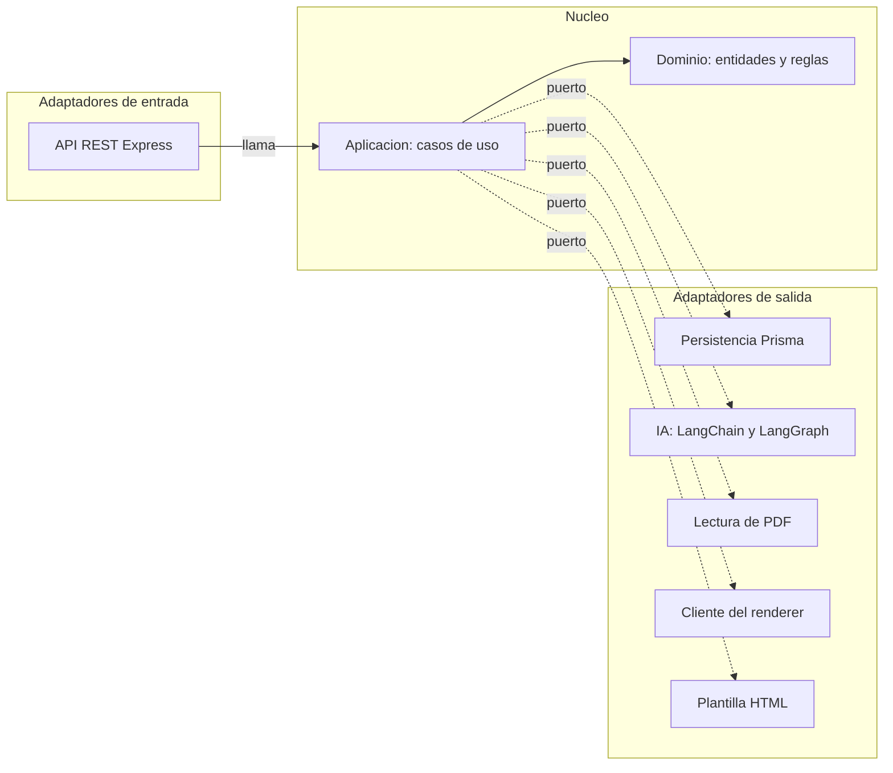
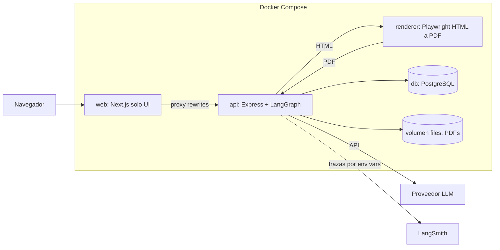
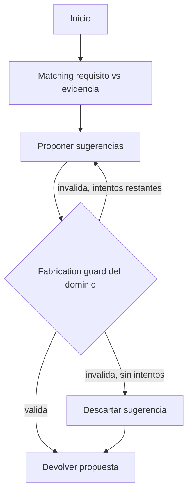
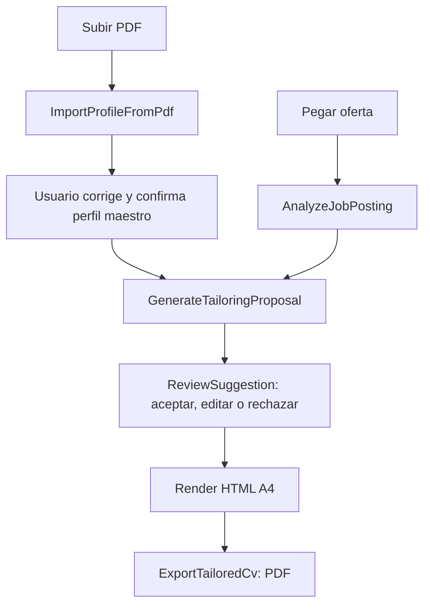

# 02 - Arquitectura

## 1. Arquitectura hexagonal (puertos y adaptadores)

El núcleo (dominio y aplicación) no conoce ni frameworks, ni base de datos, ni LLM, ni HTTP. Define puertos (interfaces) y los adaptadores los implementan. La dependencia siempre apunta hacia adentro.



Capas:

- **Dominio**: entidades (Profile, Bullet, JobPosting, Requirement, Suggestion...), objetos de valor y servicios de dominio puros: el fabrication guard, la normalización de keywords y alias, y las reglas de transición de estado de las sugerencias. Sin dependencias externas salvo Zod.
- **Aplicación**: casos de uso (`ImportProfileFromPdf`, `AnalyzeJobPosting`, `GenerateTailoringProposal`, `ReviewSuggestion`, `ExportTailoredCv`) y la definición de los puertos.
- **Puertos de salida** (definidos por la aplicación): `ProfileRepository`, `JobPostingRepository`, `TailoredCvRepository`, `ProfileExtractor` (de texto a perfil estructurado), `JobAnalyzer`, `TailoringProposer`, `PdfTextReader`, `CvHtmlRenderer`, `PdfGenerator`, `FileStorage`.
- **Adaptadores de entrada**: la API REST de Express. Valida con Zod, traduce HTTP a llamadas de casos de uso y errores de dominio a códigos HTTP.
- **Adaptadores de salida**: Prisma (repositorios), LangChain/LangGraph (extractor, analizador y proponedor), librería de PDF (lector de texto), cliente HTTP del servicio renderer, plantilla HTML.
- **Raíz de composición**: en `apps/api`. Es el único lugar donde se conectan casos de uso con adaptadores concretos (inyección de dependencias manual, sin contenedor DI).

Beneficio: los casos de uso se prueban sin LLM, sin base de datos y sin red, con adaptadores falsos en memoria; el proveedor de LLM, la base de datos o el generador de PDF se reemplazan sin tocar el núcleo.

Regla de pragmatismo: puertos solo donde hay una dependencia externa real. Sin interfaces por costumbre.

## 2. Servicios (Docker Compose)



- `web`: Next.js usado solo como interfaz (sin lógica de servidor propia). Las llamadas a `/api/*` se reenvían a `api` con `rewrites` (ADR-017); `api` no publica puertos al host y no usa CORS.
- `api`: Express con el adaptador HTTP, los casos de uso y los adaptadores de salida. Ejecuta los grafos de LangGraph dentro del proceso.
- `renderer`: servicio HTTP interno mínimo que recibe HTML y devuelve el PDF con Playwright. No conoce el dominio y no publica puertos al host.
- `db`: PostgreSQL 18 (ADR-013) con volumen `pgdata` montado en `/var/lib/postgresql`. `api` arranca cuando el `healthcheck` de `db` está sano. Las migraciones de Prisma se ejecutan como paso explícito.
- Volumen `files`: PDFs subidos y exportados, accedidos por el puerto `FileStorage`.
- Archivos: `docker-compose.yml` (base) y `docker-compose.dev.yml` (override con volúmenes y hot reload). Secretos solo en `.env`, con un `.env.example` versionado.

## 3. IA: LangChain y LangGraph (dentro del adaptador de IA)

LangChain provee los modelos, parsers de salida estructurada (Zod) y prompts. LangGraph modela cada proceso de generación como un grafo con estado y reintentos. Todo vive en el adaptador de IA, que implementa los puertos `ProfileExtractor`, `JobAnalyzer` y `TailoringProposer`.

Grafos (sin estado persistente entre llamadas):

- **extractProfileGraph**: estructura el texto del CV a perfil, valida contra el esquema y reintenta con el error si falla.
- **analyzeJobGraph**: segmenta la oferta, clasifica requisitos, extrae palabras clave y normaliza alias.
- **proposeTailoringGraph**: hace el matching, propone sugerencias y las valida con el fabrication guard (servicio de dominio que el grafo invoca). Si falla, reintenta con el motivo hasta N veces y descarta lo que sigue inválido.



**La revisión humana NO se modela dentro de LangGraph**, sino en la capa de aplicación (ADR-015). Cada `Suggestion` se guarda con su estado (pendiente, aceptada, editada, rechazada) y el usuario lo cambia mediante el caso de uso `ReviewSuggestion`. Los grafos quedan sin estado, sin checkpointer y sin ejecuciones pausadas.

El proveedor del LLM es OpenAI (ADR-011) y se elige por configuración dentro del adaptador, mediante una fábrica de modelos (`ModelFactory`) que lee el `.env`:

- `LLM_PROVIDER=openai`
- `LLM_MODEL=<modelo>`
- `OPENAI_API_KEY=...`
- `LLM_TEMPERATURE` (opcional)

La fábrica es un registro `proveedor -> constructor`. Para sumar otro proveedor se instala su paquete de LangChain y se registra una entrada, sin tocar dominio, aplicación ni grafos. `api` valida al arrancar las variables del proveedor activo.

## 4. Monitoreo con LangSmith

Solo configuración, sin código propio de observabilidad. LangChain y LangGraph envían las trazas automáticamente cuando están definidas estas variables en el servicio `api`:

- `LANGSMITH_TRACING=true`
- `LANGSMITH_API_KEY=...`
- `LANGSMITH_PROJECT=cv-tailor`
- `LANGSMITH_ENDPOINT` (solo si se usa una región distinta)

Van en `.env` y `.env.example`. Para apagarlo: `LANGSMITH_TRACING=false` (ADR-019). Con el trazado activado, el contenido que sí se envió al modelo queda guardado en LangSmith. Los datos de contacto no salen del perfil (ADR-019). No se construyen datasets de evaluación ni anonimizadores en el alcance actual.

## 5. Stack

- Monorepo: pnpm workspaces (ADR-012), con `packageManager` fijado y Corepack. Turborepo no se usa por ahora (D26). Node 24.19.0 fijado en `.nvmrc` y en las imágenes de `api` y `web`. `renderer` usa la imagen oficial de Playwright, que trae su propia versión de Node.
- Backend: Express 5 con TypeScript, validación con Zod en el borde HTTP, logging con pino.
- Frontend: Next.js + TypeScript solo como UI, Tailwind, y un cliente de la API tipado con los contratos compartidos.
- Datos: Prisma con PostgreSQL (ADR-013).
- IA: `@langchain/core`, `@langchain/langgraph` y `@langchain/openai` (ADR-011).
- PDF: `unpdf` o `pdfjs-dist` para extraer texto, Playwright en `renderer` para HTML a PDF.
- Pruebas: Vitest (dominio y aplicación con adaptadores falsos, adaptadores con pruebas de integración) y Playwright test para e2e.
- Límites hexagonales: `dependency-cruiser` en CI (ADR-016), con parser `swc` porque la versión 18 no lee TypeScript 7. Configuración en `.dependency-cruiser.cjs`; comprobación local con `pnpm boundaries`.

## 6. Flujo principal



## 7. Regla anti-invención (fabrication guard)

Decisión en ADR-018. Una sugerencia solo es válida si (a) referencia evidencia existente del perfil, y (b) todo término técnico, empresa, número o fecha del texto nuevo aparece en el perfil o en las "habilidades declaradas por el usuario".

- Permitido: reordenar, resumir, reformular, enfatizar y usar el vocabulario de la oferta para algo que el candidato sí hizo.
- Prohibido: añadir skills, herramientas, logros o cifras no respaldados.

El guard es un servicio de dominio determinista (sin LLM).

## 8. Estructura del monorepo

```
cv-tailor/
  docker-compose.yml          # web + api + renderer + db (PostgreSQL)
  docker-compose.dev.yml      # override de desarrollo
  .env.example                # LLM (LLM_PROVIDER, OPENAI_API_KEY...), DATABASE_URL y LangSmith
  .dependency-cruiser.cjs     # límites hexagonales (ADR-016)
  .github/workflows/ci.yml    # typecheck y límites
  scripts/boundaries.mjs      # falla si hay violaciones o si no se pudo leer TypeScript
  pnpm-workspace.yaml         # workspaces, catálogo y allowBuilds de @swc/core
  .nvmrc
  tsconfig.base.json
  docs/                       # documentación y decisiones
  apps/
    api/                      # Express: adaptador HTTP de entrada y raíz de composición
    web/                      # Next.js: solo UI
    renderer/                 # servicio Playwright: HTML a PDF
  packages/
    domain/                   # entidades, objetos de valor, servicios de dominio (guard, keywords)
    application/              # casos de uso y puertos
    contracts/                # esquemas Zod de DTOs compartidos entre api y web
    adapter-persistence/      # Prisma + PostgreSQL: implementa los repositorios y FileStorage
    adapter-ai/               # LangChain y LangGraph: ModelFactory, extractor, analizador, proponedor
    adapter-pdf-reader/       # PDF a texto
    adapter-pdf-renderer/     # cliente HTTP hacia el servicio renderer
    adapter-cv-template/      # plantilla HTML/CSS A4 (de datos a string HTML)
    config/                   # reservado para ESLint compartido; todavía no existe
  tests/                      # e2e
```

Reglas de dependencias (verificadas con `pnpm boundaries`):

- `domain` no depende de nada del monorepo. La única librería externa permitida es Zod.
- `application` depende solo de `domain`.
- `contracts` depende solo de `domain` (o de nada del monorepo) y de Zod.
- Cada `adapter-*` depende de `application` y `domain`, y de sus librerías externas. Nunca de otro adaptador ni de `contracts`.
- `apps/api` depende de `application`, `contracts` y los adaptadores (es la raíz de composición). No importa `domain`, `web` ni `renderer`.
- `apps/web` depende solo de `contracts` dentro del monorepo.
- `apps/renderer` no depende de ningún paquete: recibe HTML y devuelve PDF.
- Express solo se importa desde `apps/api`. Prisma solo desde `adapter-persistence`. LangChain, LangGraph y el paquete `openai` solo desde `adapter-ai`. Playwright solo desde `apps/renderer`.
- Ningún paquete interno importa de `apps/*`.
