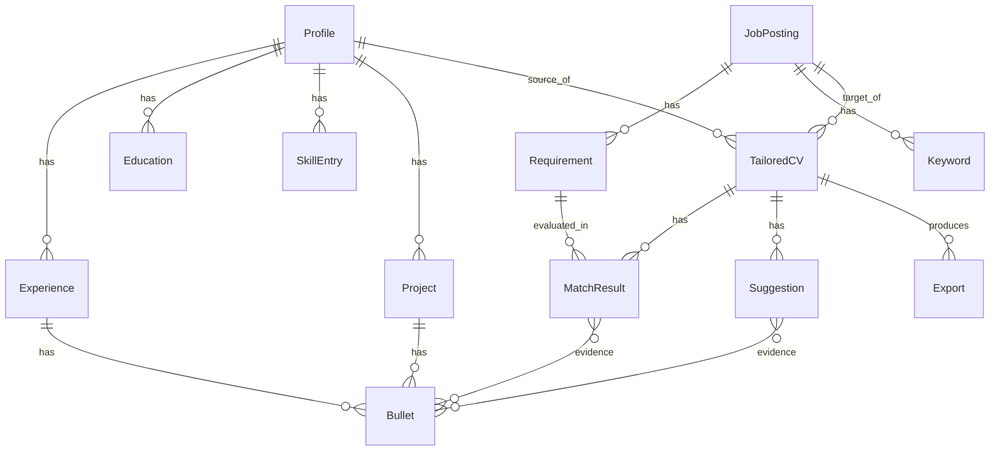

# 03 - Modelo de dominio

Todas las entidades viven en el paquete `domain` (no son modelos de Prisma). El adaptador de persistencia las mapea a tablas.

## Entidades

- **Profile**: perfil maestro (contacto, resumen, idioma), con estado `needs_review` o `confirmed`. Contiene `Experience`, `Education`, `SkillEntry` y `Project`. Cada `Bullet` tiene un id estable, único en todo el perfil, para citarlo como evidencia. Confirmar exige nombre, idioma y, cuando el bloque existe, organización y rol en cada experiencia, institución y título en cada formación, y nombre en cada proyecto.
- **JobPosting**: texto original, título, empresa, idioma, hash.
- **Requirement**: texto, tipo (técnico o funcional), prioridad (obligatorio o deseable).
- **Keyword**: término canónico, alias, frecuencia, origen.
- **TailoredCV** (agregado raíz de la revisión): versión adaptada de un Profile para un JobPosting, con estado (borrador, en revisión, final) y snapshot de contenido. Posee sus `Suggestion`, `MatchResult` y `Export`.
- **MatchResult**: requisito, estado (cubierto, parcial, brecha), IDs de evidencia, nota.
- **Suggestion**: objetivo (resumen, bullet u orden de habilidades), antes, después, motivo, evidencia, estado (`pending`, `accepted`, `edited`, `rejected`) y resultado de validación (`not_checked`, `valid` o `invalid`). Solo se revisa desde `pending`. Editar sustituye el texto y vuelve a dejar la validación en `not_checked`.
- **Export** (`CvExport`): clave de almacenamiento del PDF (`storageKey`), fecha (`createdAt`) y versión (desde 1).
- **SkillEntry** incluye `source`: `extracted_from_cv` o `declared_by_user` (ADR-018).

## Invariantes

- Toda `Suggestion` debe referenciar al menos un `Bullet` o campo del perfil existente como evidencia (ADR-018).
- El texto resultante de una `Suggestion` no puede contener términos técnicos, empresas, cifras o fechas ausentes del perfil o de las habilidades declaradas por el usuario (fabrication guard, ADR-018).
- No se exporta un `TailoredCV` mientras quede una sugerencia `pending`. Hace falta el estado `final` (ADR-025). La vista previa sí puede mostrarse antes: `pending` y `rejected` dejan el texto original.
- La instantánea de un `TailoredCV` es un perfil `confirmed`, y su id coincide con `profileId`. La evidencia citada tiene que existir en esa instantánea. Un `MatchResult` cubierto o parcial incluye al menos un bullet; una brecha puede no traer ninguno.
- Los datos de contacto del perfil (nombre, email, teléfono, ubicación y enlaces) no se envían al LLM; se reinsertan al renderizar el HTML (ADR-019). `profileForModel` devuelve el perfil sin ese bloque.

## Representación

Las entidades viven en `packages/domain` y se validan con Zod. El perfil confirmado se persiste como una fila de `Profile` cuyo `document` es el agregado en `jsonb`; al leerlo se vuelve a validar con el mismo esquema. Los identificadores son UUID. Las fechas de experiencia y educación son un mes (`AAAA-MM`) más `ongoing`: un período en curso no tiene fecha de fin, y el fin no puede ser anterior al inicio. Los ids de cada colección son únicos, igual que los nombres de habilidad (sin distinguir mayúsculas).

La evidencia de una sugerencia es un bullet, una habilidad, el resumen, una experiencia, una formación o un proyecto. Si el objetivo es un bullet, la evidencia incluye ese bullet; si es el resumen, cita el resumen; si es el orden de habilidades, cita una habilidad. `checkFabrication` revisa el texto resultante sin llamar a un modelo. Rechaza una cifra, una fecha, un acrónimo, un término del diccionario o de la oferta, o un nombre propio, cuando el perfil no lo respalda ni por el texto ni por un alias del mismo grupo. Una habilidad del perfil, extraída o declarada por el usuario, respalda su nombre. El orden de habilidades tiene que ser la misma lista, en cualquier orden. `tailoredCvStatusFor` deja el `TailoredCV` en `draft` sin sugerencias, en `in_review` si queda alguna `pending`, y en `final` cuando todas fueron aceptadas, editadas o rechazadas.

`profileForRender` arma el perfil que se imprime a partir de esa instantánea. Aplica una sugerencia solo si está `accepted` o `edited` y el fabrication guard la marcó `valid`. Una `pending` o `rejected` deja el texto original. Un bullet sustituye el texto de ese bullet, en una experiencia o en un proyecto. El resumen sustituye el resumen. El orden de habilidades es una línea por habilidad y reordena las mismas entradas, conservando id, nombre y origen; si no es esa lista, no se imprime. El contacto no cambia. La instantánea guardada tampoco. La plantilla imprime ese perfil en una columna A4: contacto, perfil, experiencia, proyectos, habilidades y educación (ADR-026). Ese HTML se convierte a PDF en el servicio `renderer` (ADR-024). `ExportTailoredCv` lo guarda solo si el estado es `final`: suma una `CvExport` con versión correlativa y escribe el archivo en `FileStorage`. Una sugerencia `pending` bloquea la exportación. Un borrador sin sugerencias tampoco se exporta.

## Oferta y cobertura

`normalizeKeywordDrafts` pliega mayúsculas, acentos y puntuación, y une términos del diccionario de alias (`Postgres` con `PostgreSQL`, `JS` con `JavaScript`). No mezcla grupos distintos: `Java` no es alias de `JavaScript`, ni `SQL` de `PostgreSQL`. La frecuencia se suma y los orígenes se concatenan.

`matchProfileToJob` compara el perfil confirmado con la oferta guardada y devuelve un informe, no una entidad persistida. Cada requisito sale cubierto si todos sus términos aparecen en bullets, parcial si aparece solo una parte, y brecha si no hay bullet. La evidencia de un cubierto o parcial es al menos un bullet. Una habilidad que coincide, sin bullet, deja el requisito en brecha y lo explica en la nota. Una keyword está presente si aparece en un bullet, una habilidad, el resumen, un rol, un estudio o un proyecto; si no está, no se puede incorporar. El informe incluye el texto de los bullets citados. Si los idiomas difieren, `languageNotice` lo dice y los textos no se traducen (ADR-022).
