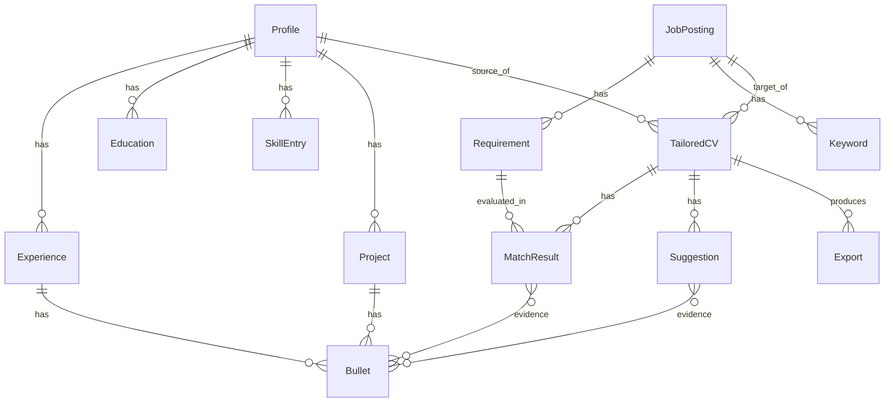

# 03 - Modelo de dominio

Todas las entidades viven en el paquete `domain` (no son modelos de Prisma). El adaptador de persistencia las mapea a tablas.

## Entidades

- **Profile**: perfil maestro (contacto, resumen, idioma). Contiene `Experience`, `Education`, `SkillEntry`, `Project`. Cada `Bullet` tiene ID estable para ser citado como evidencia.
- **JobPosting**: texto original, título, empresa, idioma, hash.
- **Requirement**: texto, tipo (técnico o funcional), prioridad (obligatorio o deseable).
- **Keyword**: término canónico, alias, frecuencia, origen.
- **TailoredCV** (agregado raíz de la revisión): versión adaptada de un Profile para un JobPosting, con estado (borrador, en revisión, final) y snapshot de contenido. Posee sus `Suggestion`, `MatchResult` y `Export`.
- **MatchResult**: requisito, estado (cubierto, parcial, brecha), IDs de evidencia, nota.
- **Suggestion**: objetivo (campo o bullet), antes, después, motivo, evidencia, estado (pendiente, aceptada, editada, rechazada), resultado de validación. Las transiciones de estado son reglas del dominio.
- **Export**: archivo PDF generado, fecha, versión.
- **SkillEntry** incluye la marca `source` (extraída del CV o declarada por el usuario).

## Invariantes

- Toda `Suggestion` debe referenciar al menos un `Bullet` o campo del perfil existente como evidencia (ADR-018).
- El texto resultante de una `Suggestion` no puede contener términos técnicos, empresas, cifras o fechas ausentes del perfil o de las habilidades declaradas por el usuario (fabrication guard, ADR-018).
- Un `TailoredCV` no puede exportarse si tiene sugerencias en estado pendiente (decisión a confirmar al implementar el caso de uso `ExportTailoredCv`).
- Los datos de contacto del perfil (nombre, email, teléfono, ubicación y enlaces) no se envían al LLM; se reinsertan al renderizar el HTML (ADR-019).
